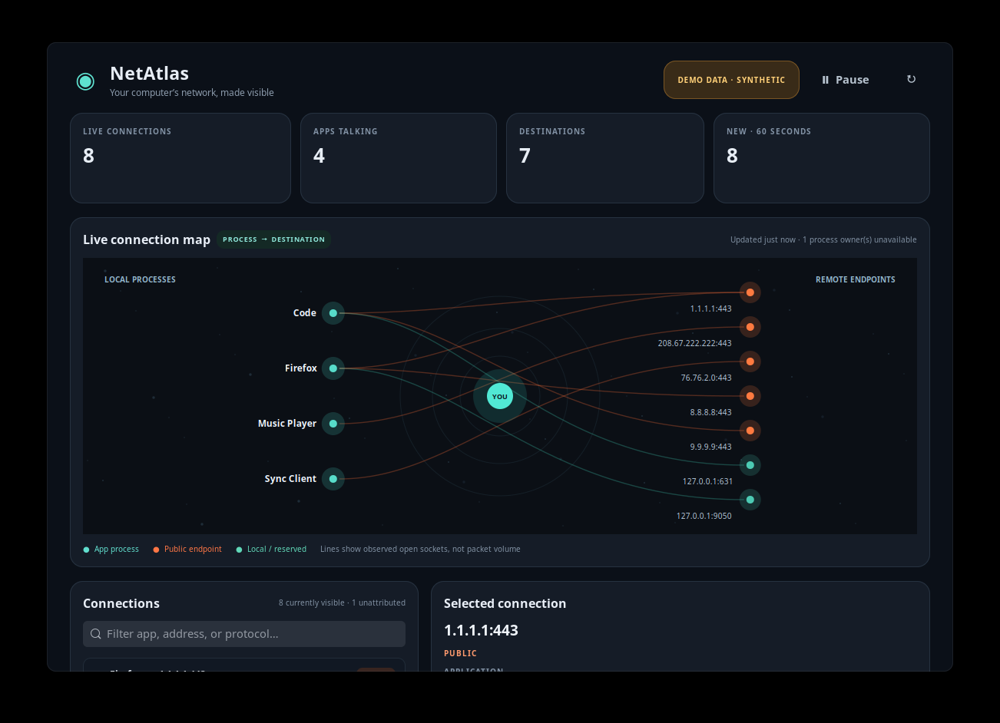

# NetAtlas

**See which apps on your Linux desktop are talking to the network.** NetAtlas
turns visible live sockets into a native, animated process-to-destination atlas,
with a searchable connection list and a detail inspector.



NetAtlas reads Linux `/proc` data every ~1.8 seconds. It is read-only, works as
your regular user, and has no daemon, account, telemetry, or remote lookups.

## Install on Ubuntu

```bash
sudo apt update
sudo apt install python3-gi gir1.2-gtk-4.0 gir1.2-adw-1
git clone https://github.com/stevenmcsorley/netatlas.git
cd netatlas
./install.sh
```

Launch **NetAtlas** from Applications, or run `~/.local/bin/netatlas-gui`.
The source launcher is `./bin/netatlas-gui`.

Build an Ubuntu `.deb` with `./packaging/build-deb.sh`; install it with
`sudo apt install ./dist/netatlas_0.1.0_all.deb` and remove it with
`sudo apt remove netatlas`. For a user install, run `./uninstall.sh` from the
source checkout. NetAtlas installs no system service or security rules.

## What the map means

- A line represents a socket currently visible in `/proc/net/tcp*` or
  `/proc/net/udp*`; it is not a measure of bytes or traffic volume.
- App ownership is matched through `/proc/PID/fd` socket inodes. Restricted
  processes may appear as unattributed; use a root monitor only if you
  independently decide broader visibility is needed.
- The map shows local processes and literal IP endpoints. It does not infer
  physical locations, resolve domain names, inspect packet contents, or use
  threat-intelligence services.
- “Public” means only that the IP is globally routable. It does **not** mean
  suspicious, unsafe, or unfamiliar. A new connection is an observation, not
  an alert.
- Current sockets are sampled periodically. Very short-lived connections can
  begin and end between samples and therefore may not appear.

Those limits are deliberate: the first version does not need root, packet
capture, kernel modules, firewall changes, or a background daemon. It is a
visual awareness tool, not an antivirus, firewall, or intrusion detector.

## Privacy

All monitoring stays local. NetAtlas does not open packet payloads, persist a
connection history, geolocate addresses, or send telemetry. The in-memory
“new in the last minute” count resets when the app closes.

## Development

On Ubuntu with GTK 4 and Libadwaita installed:

```bash
PYTHONPATH=src /usr/bin/python3 -m netatlas
PYTHONPATH=src /usr/bin/python3 -m unittest discover -s tests -v
```

The dashboard is GTK4/Libadwaita with a Cairo-drawn atlas. The monitor reads
`/proc/net` and resolves socket inode ownership in `/proc/PID/fd` off the UI
thread. Process start times are checked around descriptor inspection to avoid
attributing a connection to a reused PID.

## Screenshots

The repository screenshot uses clearly marked fictional demo values, not a
snapshot of a user's machine. Regenerate it with
`PYTHONPATH=src /usr/bin/python3 tools/capture_demo_screenshot.py` on a desktop
session; the tool substitutes synthetic data only inside its own process.

## License

[MIT](LICENSE) © 2026 Steven McSorley.
